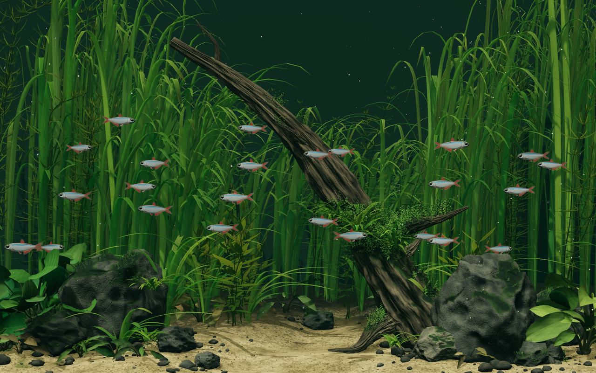
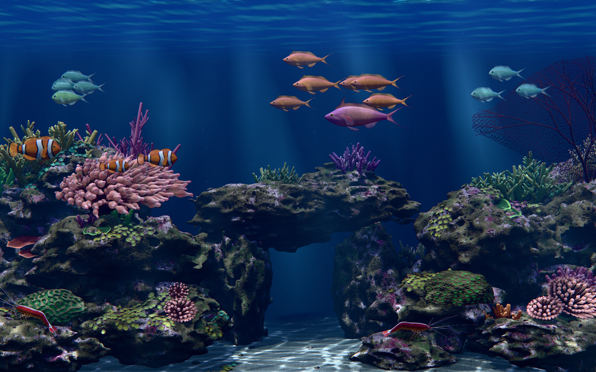
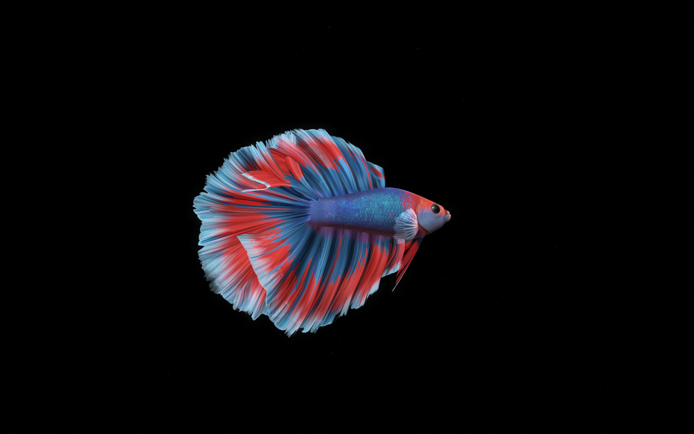
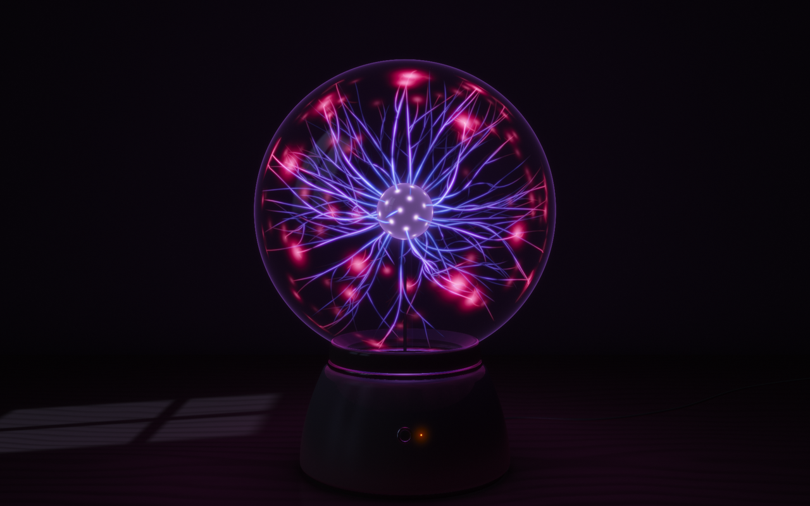
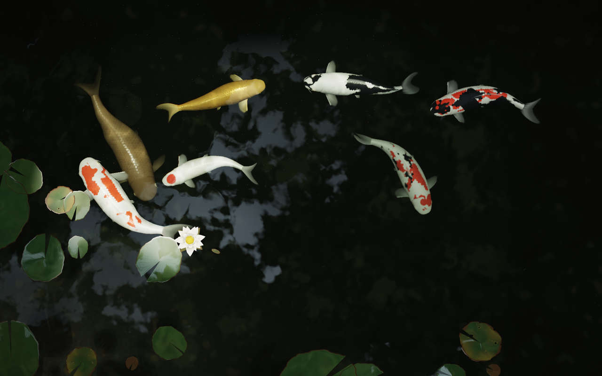
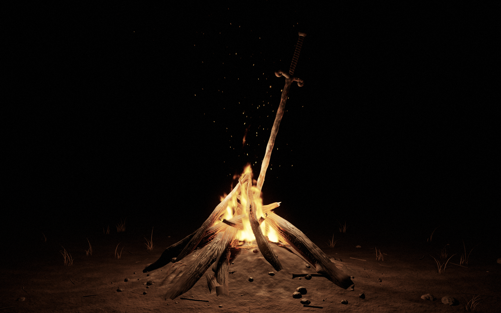
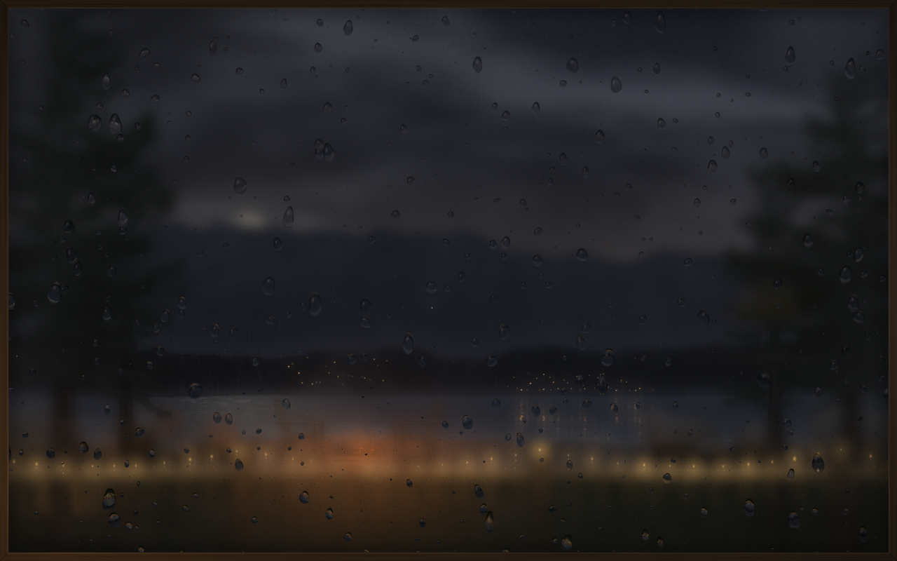

# Deskworlds for Windows（桌面世界）

**把活的 3D 世界，变成你的 Windows 桌面壁纸。**

7 个可交互的实时渲染场景——鱼群游动、水草摇曳、火焰跳动、电弧闪烁——铺满整个桌面，位于图标之下、窗口之下，**桌面图标正常显示、照常点击**。

> 场景源自 [chaseleantj/deskworlds](https://github.com/chaseleantj/deskworlds)（MIT），本复刻**未修改任何场景代码**，只重写了 Windows 原生外壳。

| 🖼 全屏动态场景 | 🖱 鼠标交互 | 🖥 图标正常 | ⚙️ 托盘控制 | 🔋 智能节能 | 🔒 纯本地 |
|:---:|:---:|:---:|:---:|:---:|:---:|
| 7 个 3D 世界 | 鱼跟随光标、可投喂 | 图标浮于场景之上 | 中文菜单一键切换 | 电池/遮挡自动降帧 | 不联网不上传 |

---

## ✨ 七个世界

| | |
|:---:|:---:|
| **🌿 河床** · Riverbed<br> | **🪸 珊瑚礁** · Coral reef<br> |
| **🐟 斗鱼** · Betta<br> | **⚡ 等离子球** · Plasma globe<br> |
| **🎏 锦鲤池** · Koi pond<br> | **🔥 篝火** · Bonfire<br> |
| **🌧 湖上风暴** · Lake storm<br> | |

> 以上为场景本身的渲染画面。实际使用时，桌面图标会浮在场景之上，双击/右键完全正常。
> 按 **Win + D** 即可看到全屏动态桌面。

---

## 目录

- [七个世界](#-七个世界)
- [环境要求](#环境要求)
- [安装](#安装)
- [使用](#使用)
- [工作原理](#工作原理)
- [目录结构](#目录结构)
- [配置](#配置)
- [故障排查](#故障排查)
- [已知限制](#已知限制)
- [文档索引](#文档索引)

---

## 环境要求

| 项目 | 要求 |
| --- | --- |
| 系统 | Windows 10 / 11（已在 Windows 11 22631 验证） |
| Python | 3.10+（已在 3.13 验证） |
| 运行时 | WebView2 Runtime（Win11 通常已预装） |
| 显卡 | 支持 WebGL2（现代集成显卡即可，独立显卡更流畅） |

依赖（`install.bat` 自动安装）：`pywin32`、`pywebview`（提供 WebView2 的 .NET 程序集）、`pystray`、`pillow`。

> 为什么用 Python？本机未安装 .NET SDK / Visual Studio，而 pythonnet（随 pywebview 提供）可直接调用 WebView2，无需编译。

---

## 安装

### 1. 准备目录

确保上游仓库与本目录**同级**：

```
某目录/
├── deskworlds/        ← 原项目（git clone https://github.com/chaseleantj/deskworlds）
└── deskworlds-win/    ← 本复刻
```

### 2. 安装

双击 **`install.bat`**：自动安装 Python 依赖 + 注册开机自启。

### 3. 启动

双击 **`run.bat`** 立即启动（或注销/重启后自动启动）。

> 首次启动会弹出一个控制台窗口，**2 秒后自动最小化**（避免挡住壁纸），这不是程序关闭。

---

## 使用

### 查看壁纸

按 **Win + D** 最小化所有窗口，即可看到全屏动态场景，桌面图标浮在场景之上。

### 托盘菜单

在**屏幕右下角系统托盘**找到"桌面世界"图标，**左键点击**弹出中文菜单：

| 菜单项 | 功能 |
| --- | --- |
| 状态：运行中 · N FPS | 实时帧率显示 |
| 🌍 切换世界 | 河床 / 珊瑚礁 / 斗鱼 / 等离子球 / 锦鲤池 / 篝火 / 湖上风暴 |
| 🐟 投喂食物 | 撒鱼食，鱼会游过来吃（河床/珊瑚礁/斗鱼/锦鲤） |
| 🔥 搅动篝火 | 搅动篝火（篝火世界） |
| 💡 节日彩灯 | 开关小屋彩灯（湖上风暴世界） |
| ⏸ 暂停 / ▶ 继续播放 | 暂停或恢复动画 |
| 🖥 临时看桌面图标 | 备用：极端情况临时隐藏壁纸（正常情况下不需要） |
| 🔄 重新加载 | 重新加载当前世界 |
| ❌ 退出 | 退出程序 |

> **投喂说明**：鱼食是毫米级小颗粒、缓慢下沉，视觉上比较细微。每次投喂后托盘会弹"已投喂食物 🐟"提示确认，仔细看水面能看到小鱼游向食物。

### 停止 / 卸载

- 停止：双击 `stop.bat`，或托盘菜单点"❌ 退出"
- 卸载：双击 `uninstall.bat`（只删自启项，不删配置和场景）

---

## 工作原理

原项目架构是「平台无关的 Web 场景 + 极薄的原生壳」。Mac 版用 Swift + WKWebView 做壳；本复刻用等价的 Windows 技术做壳：

| 原项目（macOS） | 本复刻（Windows） |
| --- | --- |
| WKWebView | **WebView2**（Edge Chromium） |
| `deskworlds://local` 私有 scheme | WebView2 虚拟主机名映射 `https://deskworlds.local/` |
| `.desktopWindow` 窗口层级 | **壁纸层 WorkerW 挂载**（`0x052C` 分离 + `WS_CHILD` + `SetParent`） |
| `ignoresMouseEvents = true` | `WS_EX_TRANSPARENT` 鼠标穿透 |
| `NSEvent.mouseLocation` 轮询 | `GetCursorPos` 轮询 → 合成 `PointerEvent` |
| IOKit 电池状态 | `GetSystemPowerStatus` |
| `CGWindowList` 遮挡检测 | `GetForegroundWindow` + 16×10 网格采样 |
| launchd 登录项 | 注册表 `HKCU\...\Run` |
| NSStatusItem 菜单栏 | pystray 系统托盘 |
| `window.scene*` 接口 | 完全一致（注入脚本 + `ExecuteScriptAsync`） |

### 关键：窗口如何"卡"在图标和壁纸之间

这是整个项目最核心的技术点。Windows 桌面窗口结构（从下到上）：

```
静态壁纸  →  壁纸层 WorkerW  →  [我们的场景窗口]  →  图标层 WorkerW(SHELLDLL_DefView/SysListView32)  →  普通应用窗口
```

实现步骤：
1. 向 `Progman` 发送未公开消息 `0x052C`，**参数必须是 `wParam=0xD, lParam=0x1`**（Win11 有效；`0,0` 无效）。
2. 系统分离出两个 WorkerW：一个承载图标（含 `SHELLDLL_DefView`），一个空的壁纸层。
3. 找到图标层 WorkerW **之后**的那个空 WorkerW（即壁纸层）。
4. 给场景窗口加 `WS_CHILD` 样式，`SetParent` 到壁纸层 WorkerW。

这样场景就在「图标之下、静态壁纸之上」，图标自然显示在最上层。

> 详细技术说明见 [`docs/ARCHITECTURE.md`](docs/ARCHITECTURE.md)。

---

## 目录结构

```
deskworlds-win/
├── host/                    # Python 宿主
│   ├── main.py              # 入口：UI 线程 / 轮询线程 / 托盘组装
│   ├── bridge.py            # WebView2 封装 + 脚本注入 + scene* 接口桥
│   ├── desktop.py           # Win32：WorkerW 挂载、鼠标穿透、光标/电源/遮挡
│   ├── tray.py              # 系统托盘菜单（中文）
│   ├── config.py            # 配置持久化 + 世界注册表
│   ├── singleton.py         # 单实例 PID 文件锁
│   ├── autostart.py         # 开机自启管理
│   └── verify.py            # 端到端验证脚本（开发用）
├── docs/
│   ├── images/worlds/       # 7 个世界的展示截图
│   ├── ARCHITECTURE.md      # 架构与技术细节
│   └── TROUBLESHOOTING.md   # 故障排查
├── tools/
│   └── capture_screenshots.py  # 批量重新生成展示截图
├── PRD.md                   # 产品需求文档
├── CHANGELOG.md             # 变更记录
├── README.md                # 本文件
├── install.bat              # 安装（依赖 + 自启）
├── run.bat                  # 启动
├── stop.bat                 # 停止
└── uninstall.bat            # 卸载
```

> 重新生成展示截图：`python tools/capture_screenshots.py`（会依次加载 7 个世界并截图到 `docs/images/worlds/`）。

**运行时文件**（`%APPDATA%\Deskworlds\`）：
- `config.json` — 配置
- `deskworlds.log` — 日志
- `instance.lock` — 单实例锁

---

## 配置

编辑 `%APPDATA%\Deskworlds\config.json`：

```json
{
  "world": "riverscape",
  "paused": false,
  "holidayLights": false,
  "startWithWindows": false,
  "quality": "balanced"
}
```

| 键 | 可选值 | 说明 |
| --- | --- | --- |
| `world` | riverscape / reefscape / bettascape / plasmascape / koiscape / bonfirescape / lakescape | 当前世界 |
| `paused` | true / false | 是否暂停 |
| `holidayLights` | true / false | 彩灯开关 |
| `quality` | eco / balanced / detail / native | 画质档位 |

**画质档位对照**：

| 档位 | 帧率 | 像素上限 | 适用 |
| --- | --- | --- | --- |
| eco | 20 | 105 万 | 低配 / 省电 |
| balanced（默认） | 30 | 180 万 | 通用 |
| detail | 60 | 300 万 | 高画质 |
| native | 60 | 1600 万 | 独立显卡 |

---

## 故障排查

### 双击 run.bat 后"看不到东西"？

这是正常的——动态壁纸没有自己的窗口，它铺在桌面层。按 **Win + D** 即可看到。控制台窗口 2 秒后自动最小化不是关闭。

判断是否在运行：
- 托盘里有没有"桌面世界"图标
- 日志 `%APPDATA%\Deskworlds\deskworlds.log` 是否有 `view 0 ready` 和 `attached to desktop layer`

### 桌面图标被壁纸盖住 / 看不到图标？

正常情况图标应显示在场景之上。若异常（某些 Windows 版本桌面结构不同）：
1. 托盘点"🔄 重新加载"重建窗口层级
2. 仍不行则点"🖥 临时看桌面图标"临时隐藏壁纸

### 壁纸不是全屏 / 右下角留白？

已通过 DPI 感知修复。若仍有问题，检查系统缩放设置，或反馈具体分辨率。

### 场景卡顿 / 掉帧？

- 切换到较轻的世界（河床、斗鱼）
- 把 `quality` 改为 `eco`
- 集成显卡建议关闭其他 GPU 密集型程序

### 启动报错缺少依赖？

手动安装：`python -m pip install pywin32 pywebview pystray pillow`

### 想彻底重启？

先双击 `stop.bat`，再双击 `run.bat`。**不要反复连点 run.bat**（有单实例保护，会提示"已在运行"）。

更多见 [`docs/TROUBLESHOOTING.md`](docs/TROUBLESHOOTING.md)。

---

## 已知限制

1. **多显示器**：共享同一世界选择（未实现各屏独立）。
2. **桌面整理软件**：与 360 桌面助手等可能有层级冲突。
3. **加载速度**：珊瑚礁场景首帧约 10 秒（含 9MB 烘焙资源）。
4. **WebMessage 通道**：本机 `postMessage` 回传异常，已改为宿主主动轮询，不影响功能。

---

## 文档索引

| 文档 | 内容 |
| --- | --- |
| [`PRD.md`](PRD.md) | 产品需求、功能清单、验收标准 |
| [`CHANGELOG.md`](CHANGELOG.md) | 版本变更、修复记录、技术演进 |
| [`docs/ARCHITECTURE.md`](docs/ARCHITECTURE.md) | 架构设计、线程模型、关键技术 |
| [`docs/TROUBLESHOOTING.md`](docs/TROUBLESHOOTING.md) | 故障排查详解 |
| [`../Deskworlds-全面分析与Windows复刻方案.md`](../Deskworlds-全面分析与Windows复刻方案.md) | 上游项目全面分析 |

---

## 与原项目的关系

- **许可**：上游 MIT，本复刻同样遵循 MIT。
- **零修改**：不修改 `deskworlds/` 任何文件；上游升级时 `git pull` 即可生效。
- **致谢**：场景与渲染全部来自 [chaseleantj/deskworlds](https://github.com/chaseleantj/deskworlds)。

---

## 许可

MIT License。详见上游项目 LICENSE。
